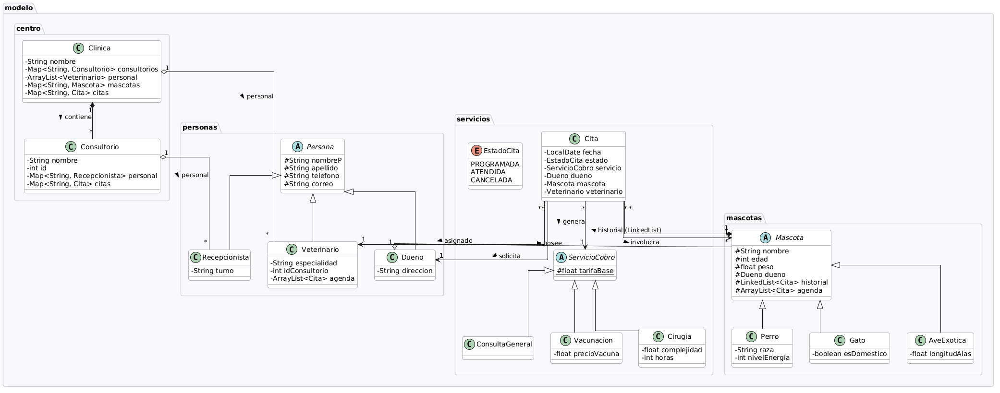

# Examen parcial Programacion orientada a objetos

## Título y descripción

### PetCare: sistema de gestión para una clínica veterinaria

PetCare es una aplicación de consola que resuelve la administración básica de una clínica veterinaria. Permite registrar dueños y sus mascotas, administrar veterinarios y consultorios, agendar y atender citas, calcular los costos de consulta, vacunación y cirugía, validar reglas de negocio, consultar historiales clínicos y mostrar el polimorfismo de los diferentes tipos de mascotas.

## Tecnologías

- **Lenguaje:** Java 27.
- **IDE:** Visual Studio Code con JDK.
- **Modelado UML:** PlantUML.
- **Ejecución:** consola de comandos.

## Modelo de la solución

### Diagrama de clases



### Decisiones de diseño

- **Herencia:** `Persona` y `Mascota` reúnen atributos y operaciones comunes. `Dueno`, `Veterinario` y `Recepcionista` heredan de `Persona`; `Perro`, `Gato` y `AveExotica` heredan de `Mascota`. `ConsultaGeneral`, `Vacunacion` y `Cirugia` heredan de `ServicioCobro`.
- **Clases abstractas:** `Persona`, `Mascota` y `ServicioCobro` no se instancian directamente. Definen una base común para sus clases concretas y, en el caso de `Mascota`, declaran operaciones polimórficas como `getTipo()` y `getSonido()`.
- **Interfaz:** el proyecto no implementa una interfaz Java; el comportamiento común se modeló mediante clases abstractas y herencia.
- **Polimorfismo:** `Clinica` trabaja con referencias de tipo `Mascota` y `ServicioCobro`, mientras cada subclase proporciona su comportamiento específico.
- **Agregación clínica-dueños:** `Clinica` mantiene un `HashMap` de dueños. Los dueños se crean fuera de la clínica y después se registran.
- **Agregación dueño-mascotas:** cada `Dueno` mantiene un `HashMap` de sus mascotas y puede reutilizarse para registrar nuevas mascotas.
- **Composición interna:** `Mascota` administra sus listas de agenda e historial clínico, que forman parte de su estado.
- **Agregación de citas y servicios:** una `Cita` relaciona una mascota, su dueño, un veterinario y un servicio de cobro.

## Estructura del proyecto

```text
petcare-poo-java/
├── src/
│   ├── app/                  # Punto de entrada y menú de consola.
│   ├── centro/               # Clínica, consultorios y administración general.
│   └── modelo/
│       ├── mascotas/         # Jerarquía de mascotas y sus sonidos.
│       ├── personas/         # Dueños, veterinarios y recepcionistas.
│       └── servicios/        # Citas, estados y servicios cobrables.
├── docs/
│   ├── analisis.md           # Análisis del proyecto.
│   └── diagramas/            # Diagrama UML e imagen de apoyo.
└── README.md
```

Aunque los archivos del modelo están organizados bajo `src/modelo/`, sus paquetes Java son `mascotas`, `personas` y `servicios`.

## Conceptos aplicados

| Concepto | Archivo y línea | Aplicación |
|---|---|---|
| Herencia | `src/modelo/personas/Dueno.java:6` | `Dueno` hereda de `Persona`. |
| Herencia | `src/modelo/mascotas/Perro.java:6` | `Perro` hereda de `Mascota`. |
| Herencia | `src/modelo/servicios/Cirugia.java:4` | `Cirugia` hereda de `ServicioCobro`. |
| Clase abstracta | `src/modelo/personas/Persona.java:4` | Define los datos comunes de las personas. |
| Clase abstracta | `src/modelo/mascotas/Mascota.java:7` | Declara el contrato común de las mascotas. |
| Polimorfismo | `src/modelo/mascotas/Mascota.java:27-31` | `getTipo()` y `getSonido()` se resuelven según la subclase. |
| Polimorfismo | `src/centro/Clinica.java:400-402` | El listado obtiene el sonido concreto de cada mascota. |
| Agregación | `src/centro/Clinica.java:14` | La clínica conserva un `HashMap<String, Dueno>`. |
| Agregación | `src/modelo/personas/Dueno.java:8` | El dueño conserva un `HashMap<String, Mascota>`. |
| Composición | `src/modelo/mascotas/Mascota.java:12-13` | La mascota administra su agenda e historial. |
| Encapsulamiento | `src/modelo/servicios/ServicioCobro.java:5-10` | El costo se protege y se consulta mediante `getTotal()`. |
| Validación | `src/centro/Clinica.java:258-264` | Se valida la compatibilidad entre especialidad y mascota. |

## Instalación y ejecución

### Requisitos

- Git.
- JDK compatible con Java 27.
- Cualquier IDE e incluso bloc de notas.

### Windows PowerShell

```powershell
git clone https://github.com/AngelSanchez18/petcare-poo-java-.git
cd petcare-poo-java-
$files = Get-ChildItem -Path .\src -Recurse -Filter *.java
javac -d .\build $files.FullName
java -cp .\build app.Main
```

### Linux o macOS

```bash
git clone https://github.com/AngelSanchez18/petcare-poo-java-.git
cd petcare-poo-java-
mkdir -p build
find src -name "*.java" -print0 | xargs -0 javac -d build
java -cp build app.Main
```

Al iniciar, elegir el número de la opción deseada y seleccionar `0` para salir.

## Ejemplo de uso

Al iniciar, el programa carga consultorios, veterinarios, dueños, mascotas y tres citas:

```text
Bienvenido a Petcare!
1.Registrar dueño y mascota
2.Registrar veterinario y asignar clinica
3.Agendar una cita
4.Atender cita
5.Cancelar cita
6.Generar comprobante de una cita atendida
7.Consultar el historial clinico de una mascota
8.Listar mascotas y su sonido
9.Ver el total cobrado por veterinario
0.Salir
Elija alguna de las opciones: 8
Mascotas registradas:
- Kiwi (Ave Exotica) - Sonido: Kakarakeo
- Max (Perro) - Sonido: Ladrido
- Luna (Gato) - Sonido: Maullido
```

El escenario completo permite registrar dueños y mascotas, registrar veterinarios, agendar tres citas, atender dos, calcular costos, rechazar una cita inválida, listar mascotas, consultar cobros y revisar un historial clínico.

## Reglas de negocio

| Regla | Validación |
|---|---|
| No se permiten dueños duplicados | `Clinica.agregarDueno()` verifica el nombre completo. |
| No se permiten mascotas duplicadas | `Clinica.agregarMascota()` busca el nombre entre los dueños. |
| Una mascota debe tener dueño | `Clinica.agregarMascota()` rechaza mascotas sin dueño. |
| La especialidad debe corresponder a la mascota | `Clinica.especialidadCompatible()` filtra veterinarios antes de agendar. |
| Un veterinario no puede tener dos citas en la misma fecha | `Veterinario.isDisponible()` revisa su agenda. |
| El consultorio debe existir | `Clinica.agregarVeterinario()` valida su identificador. |
| No se aceptan valores negativos | Las clases de dominio validan edades, pesos, energía, alas e identificadores. |
| Solo se cobran citas atendidas | Los métodos `getTotalCobrado()` consideran el estado `ATENDIDA`. |

## Reflexión
En lo personal este proyecto me sirvió mucho para saber lo complicado que es llevar a la práctica todos los conocimientos dados en esta EE, no se compara en nada unas 2 o 3 clasesitas con funciones simples que algo más grande cómo un sistema para una clínica que tiene que funcionar lo más apegado a la realidad, por lo que definitivamente siento que aprendí realizando todo esto.

En cuanto al uso de la IA, me apoyé en como usar la sintaxis de java, sobre todo en isEqual, ya que es algo nuevo que no había visto en otro lenguaje, y en la ayuda de sintaxis en este readme, ya que el markdown es algo que todavía no domino pero poco a poco voy aprendiendo, y un apoyo que personalmente me sirvió demasiado fue esta cheat sheet, que de forma fácil de entender me quedó más que claro las diferentes funciones dentro de java y su sintaxis.
[Cheat sheet en cuestión](https://it-cheat-sheets-21aa0a.gitlab.io/java-cheat-sheet.html)

## Autor

**Ángel Alberto Sánchez Ramírez**  
GitHub: [AngelSanchez18](https://github.com/AngelSanchez18)

Pagina web: www.AlbertoPro.com
