# Análisis del programa

## Funciones de ejemplo

### 1. **Registro de dueños y mascotas:** se registran dos dueños y tres mascotas: un perro, un gato y un ave exótica. Cada mascota queda asociada con su dueño.
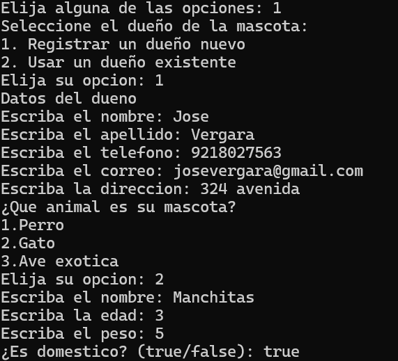
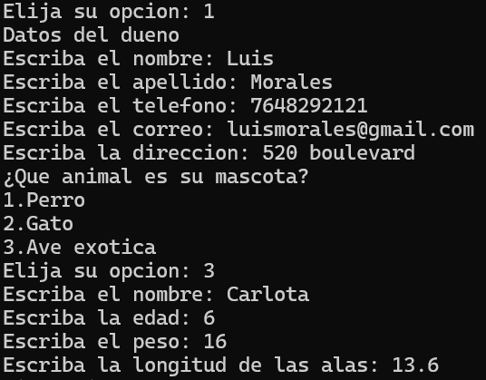
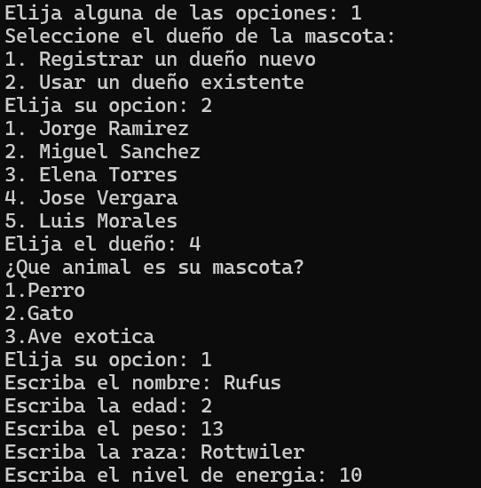

### 2. **Registro de veterinarios:** se registran dos veterinarios con sus respectivas especialidades y consultorios.
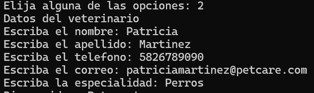
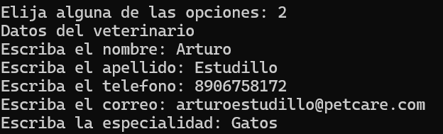

### 3. **Agenda y atención de citas:** se agendan tres citas y se atienden dos. Al atenderlas, se calculan los costos de una consulta general, una vacunación y una cirugía según el servicio seleccionado.
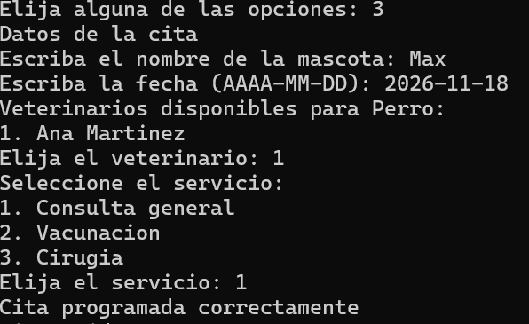
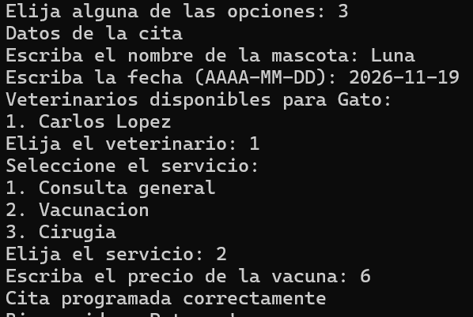
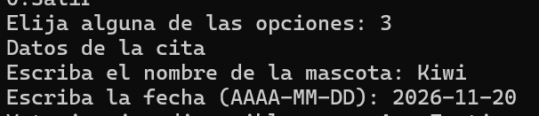
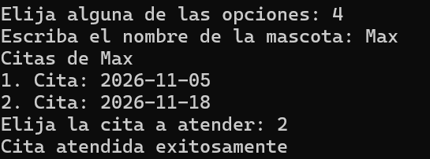
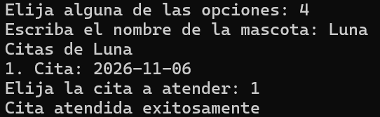

### 4. **Validación de reglas de negocio:** se intenta agendar una cita que incumple una regla, por ejemplo, utilizar un veterinario cuya especialidad no corresponde a la mascota o que no está disponible en la fecha elegida. El programa rechaza la operación y muestra un mensaje de error.
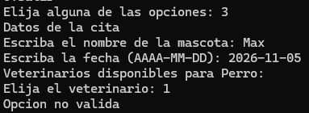
Veterinario no aparece debido a que no se encuentra disponible.

### 5. **Polimorfismo de las mascotas:** se listan las mascotas y se invoca `hacerSonido()` (implementado en el código mediante `getSonido()`), mostrando un sonido diferente para el perro, el gato y el ave.
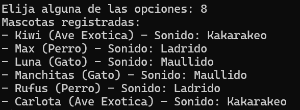

### 6. **Cobros e historial clínico:** se muestra el total cobrado por las citas atendidas y se consulta el historial clínico de una mascota, donde se observan sus citas y estados.
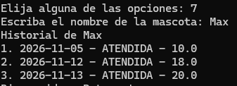